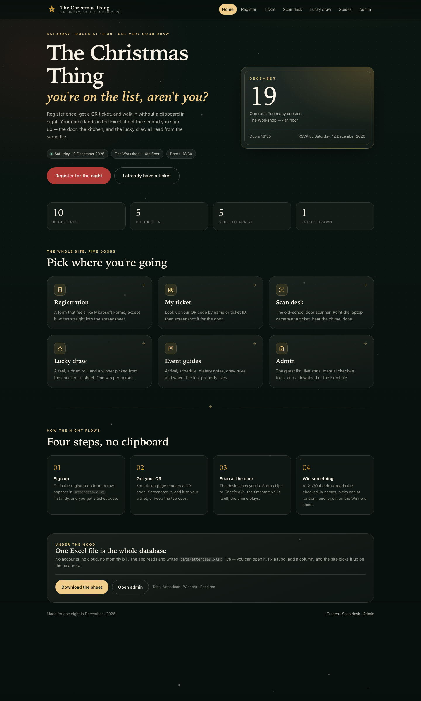
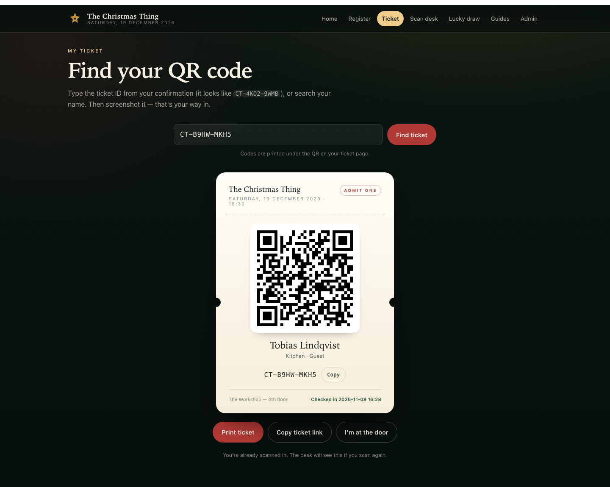

# The Christmas Thing

A one-page-per-task event site for a single night: **registration → QR ticket → door scanner → lucky draw**, with **Microsoft Excel as the database** and **event guides** anyone can edit without touching code.

No build step, no framework, no cloud account. One Python file starts the server; one Excel workbook holds the guest list.

```bash
./run.sh
```

Then open <http://127.0.0.1:8000>. `./run.sh` creates the environment for you on first run.

---

## What's in the box

| Page | Path | What it does |
|---|---|---|
| **Home** | `/` | Event details, live counts, links to everything |
| **Registration** | `/register.html` | Microsoft Forms-style form. Submitting appends a row to `data/attendees.xlsx` and mints a `CT-XXXX-XXXX` ticket |
| **My ticket** | `/ticket.html` | Look up by ticket code or name; shows the QR code, printable |
| **Scan desk** | `/scan.html` | Webcam + QR scanner (jsQR). Reads a ticket, flips the row to *Checked in*. Manual code entry fallback |
| **Lucky draw** | `/draw.html` | Animated reel, only checked-in guests, one win per person, results written to the **Winners** sheet |
| **Event guides** | `/guides.html` | Seven editable guides (arrival, schedule, food, draw rules, house rules…) |
| **Admin** | `/admin.html` | Live guest list, search/filter, manual check-in fixes, Excel download, draw reset |

The whole thing is one website with shared navigation and styling.

## Screens




---

## The Excel database (your questions, answered)

> **"How do I input their names in the database once they sign up?"**

You don't. Registration writes straight into the workbook — a new row appears the moment the form is submitted. The file is `data/attendees.xlsx`, created automatically on first run.

> **"Dynamic database."**

The workbook is read fresh whenever it changes on disk, so it behaves like a live database rather than a static export:

- **Sign-ups append themselves.** No CSV export, no import step.
- **Editing in Excel is safe.** Open `attendees.xlsx`, fix a typo or a dietary note, save. The site picks it up on the next request — no restart.
- **Adding your own columns is safe.** Add `Badge`, `Seat`, `Table`, whatever. The app maps columns by header name, keeps unknown columns, and preserves their values when it appends a new row.
- **Duplicate sign-ups are prevented.** Registering with an email that already exists returns the original ticket instead of creating a second row.
- **Already have a list?** `python scripts/import_names.py old-list.xlsx` appends names from column A (with optional email/team/role/dietary columns) and generates tickets for everyone.
- **Close the file while the door is scanning.** Excel takes a lock on the workbook. The site fails politely (`Couldn't write… close it and retry`) rather than corrupting anything.

### Workbook layout

**Attendees** sheet — one row per guest:

| Ticket ID | Name | Email | Phone | Team / Org | Role | Dietary | Notes | Registered At | Status | Checked In At | Check-in Source |
|---|---|---|---|---|---|---|---|---|---|---|---|

**Winners** sheet — one row per prize:

| Draw # | Ticket ID | Name | Prize | Drawn At |
|---|---|---|---|---|

**Read me** sheet — a plain-English note for whoever opens the file next.

Status values are exactly `Registered` and `Checked in`.

---

## QR attendance, old-school style

1. Guest registers → gets a page containing a QR code that encodes their ticket URL (`…/ticket.html?code=CT-XXXX-XXXX`).
2. Guest shows it at the door, or screenshots it for later.
3. The desk opens `/scan.html`, clicks **Start camera**, and points the webcam at the QR.
4. The server looks up the ticket, flips `Status` to `Checked in`, stamps `Checked In At`, and records the source (`scan`, `manual`, or `admin`).
5. The desk hears a chime and sees the name turn green. A second scan says "already checked in" with the original time, so nobody is counted twice.

Camera notes:

- The scanner uses `getUserMedia`, which browsers only allow on **`http://127.0.0.1` / `localhost` or HTTPS**. Run the scan desk on the desk laptop at localhost and it just works. Opening the site over plain `http://192.168.x.x` on a phone will render everything except the camera.
- If the camera can't start, type the `CT-XXXX-XXXX` code instead — the desk works identically.
- The QR codes are generated in the browser (vendored `qrcode-generator`), and decoded in the browser (vendored `jsQR`). No external services.

---

## Lucky draw rules

- Pool = `Checked in` rows (toggle available to include everyone registered).
- Previous winners are excluded, so each guest can win once.
- The winner is chosen **server-side** with `secrets.choice`, not in the browser — the page only animates the reel.
- Every result appends to the **Winners** sheet with a timestamp.
- The host can reset the winners sheet from Admin without touching registrations or check-ins.

---

## Setup

**Requirements:** Python 3.10+, one dependency (`openpyxl`).

```bash
./run.sh                    # creates .venv, installs openpyxl, starts on :8000
./run.sh --open             # ...and opens the browser
./run.sh --port 8010        # different port
./run.sh --host 127.0.0.1   # localhost only (phones on the LAN can't reach it)
```

Manual equivalent:

```bash
python3 -m venv .venv
PIP_USER=0 .venv/bin/pip install -r requirements.txt   # PIP_USER=0 only needed if your global pip uses --user
.venv/bin/python server.py --port 8000
```

Try it with demo guests:

```bash
.venv/bin/python scripts/seed_demo.py          # 6 guests, 4 checked in
.venv/bin/python scripts/seed_demo.py --all-in
```

Run the tests:

```bash
.venv/bin/python -m unittest discover -s tests -v
```

---

## Editing the event without code

**`data/event.json`** — name, tagline, date, time, venue, RSVP deadline, prize list. Pages read it on load.

```json
{
  "name": "The Christmas Thing",
  "date": "2026-12-19",
  "time": "18:30",
  "venue": "The Workshop — 4th floor",
  "prizes": ["Grand prize — noise-cancelling headphones", "…"]
}
```

**`data/guides.json`** — the guides page. Each guide has `title`, `icon`, `summary`, and `sections[]` of `{heading, body[]}`. Icons available: `ticket`, `clock`, `gift`, `plate`, `sparkle`, `heart`, `phone`.

Both files are re-read per request, so edits show up on refresh.

---

## Project structure

```
server.py               stdlib HTTP server: static files + JSON API
app/
  config.py             event.json / guides.json loading + defaults
  store.py              ExcelStore — the workbook as a database
  service.py            event rules: register, check-in, draw, stats
web/
  index.html  register.html  ticket.html  scan.html
  draw.html   guides.html    admin.html   404.html
  css/style.css         the whole design system
  js/common.js          API helper, toasts, QR, snow, chrome
  js/{register,ticket,scan,draw,guides,admin}.js
  vendor/               qrcode.min.js, jsQR.js (MIT, vendored offline)
data/
  event.json            editable event settings
  guides.json           editable guide copy
  attendees.xlsx        the database (generated, gitignored)
scripts/
  seed_demo.py          demo guests for testing
  import_names.py       bring an existing Excel list in
tests/
  test_store.py         15 tests over the store + event rules
```

### API

All JSON, no auth (see roadmap).

| Method | Path | Purpose |
|---|---|---|
| `GET` | `/api/bootstrap` | Event config, guides, stats, recent check-ins |
| `GET` | `/api/attendees?query=&status=` | Search the guest list (`status`: `present` / `pending` / `all`) |
| `GET` | `/api/ticket/{code}` | One attendee |
| `GET` | `/api/stats` | Counters |
| `POST` | `/api/register` | `{name, email, phone, team, role, dietary, notes}` |
| `POST` | `/api/checkin` | `{code, source}` |
| `POST` | `/api/checkin/undo` | `{code}` |
| `POST` | `/api/draw` | `{prize, eligible: "checked_in"\|"registered", allow_repeat}` |
| `GET` | `/api/draw/history` | Winners + stats |
| `POST` | `/api/draw/reset` | Clear the Winners sheet |
| `GET` | `/api/export` | Download `attendees.xlsx` |

---

## Roadmap (deliberately not built yet)

- **Auth on `/admin`** — it is currently open to anyone who can reach the server.
- **HTTPS** — needed if phones should scan or show tickets off localhost. A tunnel or a tiny TLS proxy solves it.
- **Live updates over SSE** instead of 10-second polling.
- **Email/SMS ticket delivery** after registration.
- **Print sheets** — a PDF of A6 tickets straight from the admin page.
- **Multi-event** — one workbook per event, or a season switcher.
- **Offline queue** at the door if the wifi hiccups.

---

## Troubleshooting

| Symptom | Fix |
|---|---|
| `Address already in use` | `./run.sh --port 8010` |
| "Could not write the workbook — it is open in Excel" | Close `attendees.xlsx`, retry |
| Camera button does nothing | Open the site at `127.0.0.1`/`localhost` or HTTPS; type the code instead |
| Stats look stale | The pages poll; reload. The server re-reads the workbook on every request |
| `openpyxl is not installed` | `./run.sh` creates the venv, or `pip install -r requirements.txt` |
| Want a clean slate | Delete `data/attendees.xlsx`; it is recreated empty on next start |
| Wrong weekday/date on the hero | Edit `data/event.json` |

---

## Short version

Register a guest. Screenshot the QR. Scan it at the door. Watch their name drop into the draw. Open the Excel file afterwards and it's all there, in order, with timestamps. That's the whole trick.
