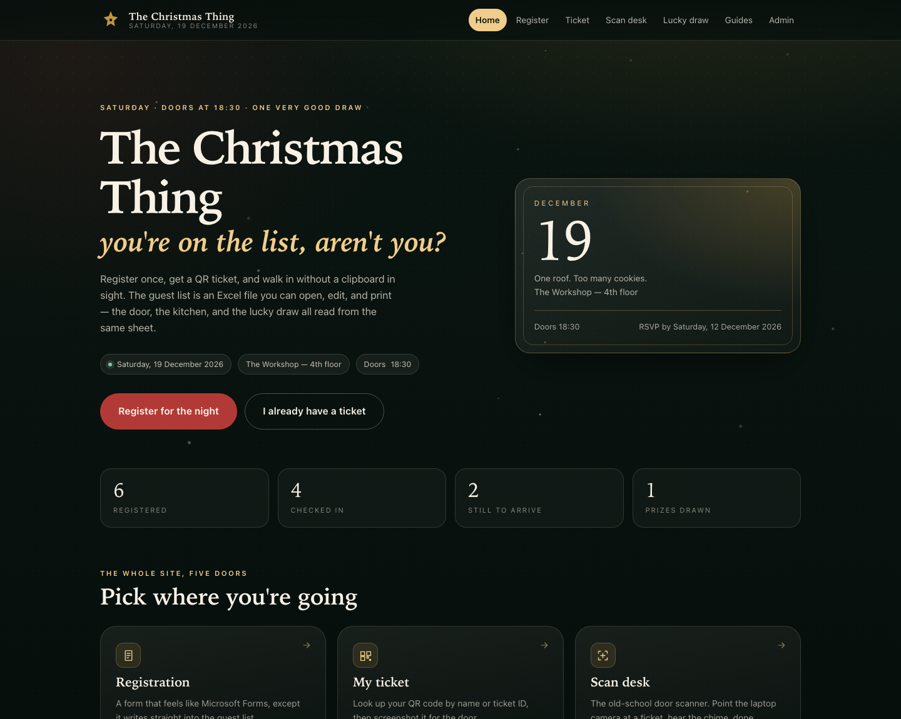
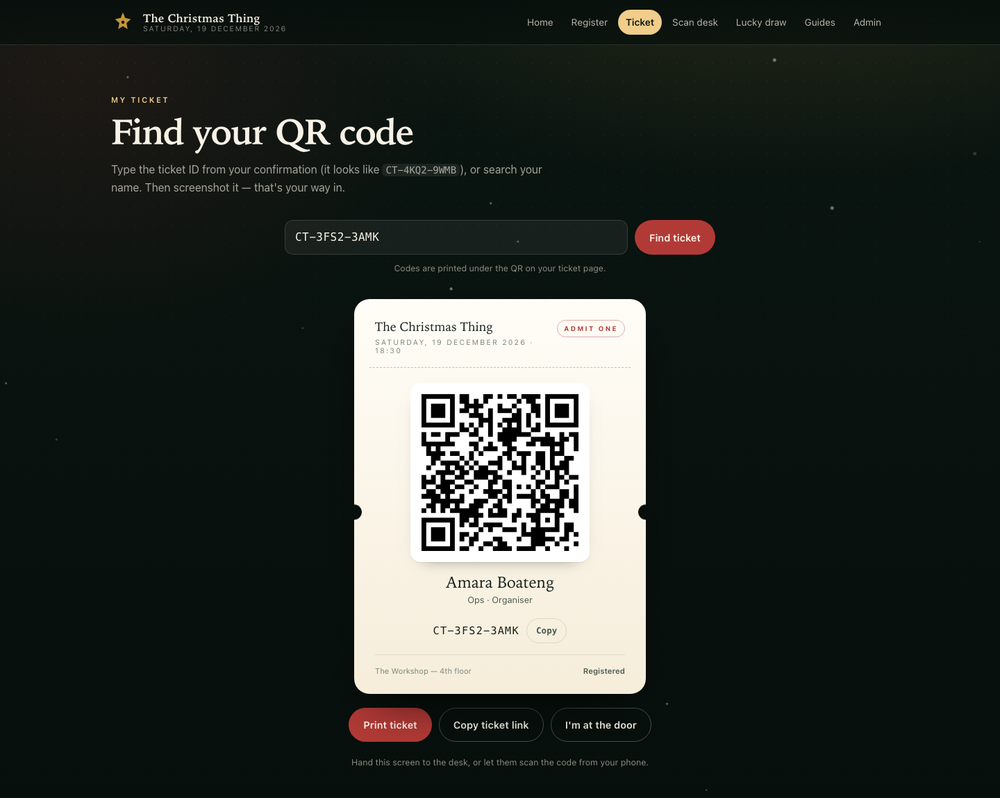
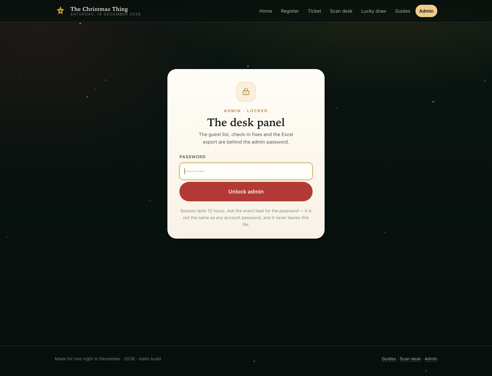

# The Christmas Thing

A one-night event site: **registration → QR ticket → door scanner → lucky draw**, plus **event guides** and an **admin guest list**. Two builds ship in this repo, same design, same features:

| Build | Where | How it stores people | Best for |
|---|---|---|---|
| **Static HTML** | `dist/index.html` | This browser's local storage + real `.xlsx` import/export | A single laptop at the door, a demo, GitHub Pages, a USB stick |
| **Python server** | `./run.sh` → `http://127.0.0.1:8000` | One live `data/attendees.xlsx` workbook | Guests registering on their own phones, LAN-wide event |





---

## Ship it: the static HTML build

Grab **`dist/index.html`** and you have the entire site — HTML, CSS, JS, QR generator, QR scanner, Excel library, event copy — in one 1.3 MB file. No server, no install, no network.

```bash
# open it
open dist/index.html

# or put it anywhere static
# (Netlify drop, GitHub Pages, S3, a USB stick, an email attachment)
```

Works by double-click from disk. If you host it (or open it via `localhost`), the camera scanner also works; on `file://` browsers block camera access, so the desk types the ticket code instead.

**What's inside the one file**

- Registration form → writes a guest row instantly and mints a `CT-XXXX-XXXX` ticket
- QR ticket page with printable ticket and deep links (`#/ticket?code=…`)
- Webcam scan desk (jsQR) with chime, manual code fallback, duplicate warnings
- Lucky draw with animated reel, checked-in-only pool, no repeat winners
- Event guides rendered from editable JSON
- Password-locked admin: guest list, manual check-ins, **Import Excel/CSV**, **Download Excel**, load demo guests, clear data
- Real `.xlsx` files with **Attendees**, **Winners**, and **Read me** sheets

### The honest caveat

The static build keeps its database in **this browser**, per device. That's perfect for a kiosk laptop where everyone registers at the door. It is *not* a shared database: a guest who registers on their phone won't appear on the desk laptop. Need that? Run the Python build on the LAN — it's the same UI against one shared Excel file.

Moving between machines is one click either way: **Admin → Download Excel**, then **Import Excel** on the other machine.

### Rebuild after editing the event

Event name, date, prizes and guide copy live in `data/event.json` and `data/guides.json`. After editing:

```bash
python3 scripts/build_static.py
```

It regenerates `static/js/data.js` and rebuilds `dist/index.html`. To develop the static build with separate files, serve `static/`:

```bash
python3 -m http.server 8000 --directory static
# http://127.0.0.1:8000
```

---

## Run it: the Python build (live shared Excel)

One Excel file *is* the database, shared across every phone and laptop on the network.

```bash
./run.sh
```

First run creates `.venv`, installs `openpyxl`, starts the server, and prints both a localhost URL and a LAN URL (use the LAN one from phones). Options: `--port 8010`, `--host 127.0.0.1`, `--open`.

- **Sign-ups append rows by themselves.** No CSV export, no import step.
- **Editing the workbook is safe.** Fix a typo or add a column in Excel; the app re-reads it on the next request. Unknown columns survive.
- **Same email, same ticket.** Duplicate sign-ups don't create duplicate rows.
- **Existing list?** `python scripts/import_names.py old-list.xlsx`
- **Close the file while the door scans.** Excel locks it; the app says so politely.
- **Camera** needs `localhost`/HTTPS. Run the desk on the laptop at `http://127.0.0.1:8000`; guests can still load tickets over the LAN URL.
- **Admin is password-gated** with a server-side session cookie; the guest list, undo, draw reset and Excel export return 401 without it.

Demo data: `.venv/bin/python scripts/seed_demo.py` (6 guests, 4 checked in).

### Workbook layout

**Attendees** — `Ticket ID · Name · Email · Phone · Team / Org · Role · Dietary · Notes · Registered At · Status · Checked In At · Check-in Source`

**Winners** — `Draw # · Ticket ID · Name · Prize · Drawn At`

Status is exactly `Registered` or `Checked in`.

---

## Admin password

Both builds lock the admin panel. Change the password before you tell anyone the URL:

```bash
python3 scripts/set_admin_password.py
# prompts without echoing, writes a PBKDF2-SHA256 salt + hash into data/event.json
# and rebuilds dist/index.html
```

The password is never stored in plain text, and it is not the same as any account password. Sessions last 12 hours (`admin.session_minutes` in `data/event.json`).

| Build | How the gate works | How strong is it |
|---|---|---|
| Static HTML | PBKDF2 verified in the browser; unlock kept in `sessionStorage`; a lock button ends it | A **screen lock**, not a vault. Anyone with devtools can read the local database, because the whole app ships to the visitor |
| Python server | Password checked server-side; HttpOnly `SameSite=Strict` session cookie; protected endpoints return 401; login rate-limited to 8 attempts per 5 minutes | Real authorization for a LAN event; still plain HTTP, so keep it on the school network |

Forgot it or locked yourself out? Re-run `scripts/set_admin_password.py`. After too many wrong guesses on the Python build, wait five minutes or restart the server.

## The five modules

| Page | Static route | Server path | What it does |
|---|---|---|---|
| Home | `#/home` | `/` | Event details, live counts, links |
| Registration | `#/register` | `/register.html` | Forms-style signup → guest row + QR ticket |
| My ticket | `#/ticket` | `/ticket.html` | Lookup by code or name, printable QR |
| Scan desk | `#/scan` | `/scan.html` | Camera QR scan → check in; manual fallback |
| Lucky draw | `#/draw` | `/draw.html` | Reel + fair winner from checked-in guests |
| Guides | `#/guides` | `/guides.html` | Editable arrival/schedule/food/rules copy |
| Admin | `#/admin` | `/admin.html` | List, search, fix check-ins, Excel in/out |

Draw rules in both builds: checked-in guests only (toggle available), previous winners excluded, one win per person, every result logged with a timestamp.

---

## Project structure

```
dist/index.html            ← the shipped single-file static site
static/                    static build source (served directly in dev)
  index.html               shell + all views + hash router
  css/style.css            design system
  js/db.js                 localStorage database + Excel import/export
  js/admin-auth.js         PBKDF2 password gate for the static build
  js/common.js             API shim, router, toasts, QR, snow
  js/{register,ticket,scan,draw,guides,admin}.js
  js/vendor/               qrcode, jsQR, SheetJS (MIT, offline)
  js/data.js               generated from data/*.json
server.py                  stdlib HTTP server (Python build)
app/
  auth.py                  PBKDF2 password check + session store
  config.py                event.json / guides.json loading
  store.py                 ExcelStore — workbook as database
  service.py               register / check-in / draw / stats rules
web/                       Python build frontend (separate static pages)
data/
  event.json               name, date, venue, prizes — edit me
  guides.json              guide copy — edit me
  attendees.xlsx           live workspace DB (generated, gitignored)
scripts/
  build_static.py          data JSON + static/ → dist/index.html
  set_admin_password.py    change the admin password (both builds)
  seed_demo.py             demo guests for the Python build
  import_names.py          import an existing .xlsx/.csv into the Python DB
tests/
  test_store.py            15 Python tests (store + event rules)
  test_auth.py             9 Python tests (password hashing + sessions)
  static_db_test.mjs       11 Node tests (browser database + xlsx round-trip)
docs/preview-*.png         screenshots
docs/event-ticketing-spec.md  production spec: Next.js + Supabase, security, budget, timeline
```

### Server API (Python build only)

| Method | Path | Purpose |
|---|---|---|
| `GET` | `/api/bootstrap` | Event config, guides, stats, recent check-ins |
| `GET` | `/api/attendees?query=&status=` | Search the list |
| `GET` | `/api/ticket/{code}` | One attendee |
| `GET` | `/api/stats` | Counters |
| `POST` | `/api/register` | Create attendee + ticket |
| `POST` | `/api/checkin` | `{code, source}` |
| `POST` | `/api/checkin/undo` | `{code}` |
| `POST` | `/api/draw` | `{prize, eligible, allow_repeat}` |
| `GET` | `/api/draw/history` | Winners + stats |
| `POST` | `/api/draw/reset` | Clear the Winners sheet |
| `GET` | `/api/export` | Download the workbook (admin) |
| `GET` | `/api/lookup?query=` | Public ticket search — no email/phone |
| `GET` | `/api/attendees` | Guest list (admin) |
| `POST` | `/api/admin/login` | `{password}` → session cookie |
| `POST` | `/api/admin/logout` | End session |
| `GET` | `/api/admin/session` | Am I logged in? |

---

## Tests

```bash
# static database + xlsx round-trip (Node, no deps)
node tests/static_db_test.mjs

# python store + event rules
.venv/bin/python -m unittest discover -s tests -v
```

The static build also gets an end-to-end pass in a real browser (form → QR → check-in → duplicate warning → draw → workbook → admin lock). All suites are green.

---

## Customising

- **Event details:** `data/event.json` — name, tagline, date, time, venue, RSVP deadline, prize list.
- **Guides:** `data/guides.json` — `{title, icon, summary, sections:[{heading, body:[]}]}`. Icons: `ticket`, `clock`, `gift`, `plate`, `sparkle`, `heart`, `phone`.
- **Colours / type:** CSS variables at the top of `static/css/style.css` (Python build uses `web/css/style.css`).
- **Static build:** always run `python3 scripts/build_static.py` after touching `data/*.json` or `static/`.

---

## Roadmap

- Admin auth for the Python build (currently open to the LAN).
- HTTPS / tunnel so phone cameras work outside localhost.
- Cross-device sync for the static build (a tiny optional worker/API).
- Email/SMS ticket delivery, A6 ticket print sheets, multi-event support.

---

## Troubleshooting

| Symptom | Fix |
|---|---|
| Static build shows someone else's old data | Admin → Clear all data, or use a private window |
| Camera button does nothing in static build | `file://` blocks cameras. Serve it on `localhost` or type codes |
| Static data vanished after an update | Different origin/profile = different storage. Export before moving |
| Python: `Address already in use` | `./run.sh --port 8010` |
| Python: workbook can't be written | Close `data/attendees.xlsx` in Excel |
| Python: `openpyxl is not installed` | `./run.sh` |
| `PIP_USER` error during venv install | `PIP_USER=0 .venv/bin/pip install -r requirements.txt` |
| Forgot the admin password | `python3 scripts/set_admin_password.py` |
| "This browser can't verify the password" (static build) | Open it through `localhost` or use Chrome/Edge/Firefox — some browsers block crypto on `file://` |
| "Too many attempts" at admin login | Wait 5 minutes, or restart the Python server |
| Changed the password but the static page rejects it | Run `python3 scripts/build_static.py` to bake the new hash into `dist/index.html` |

---

## Short version

Open `dist/index.html`, register a guest, screenshot the QR, type or scan the code at the desk, press the draw button, download the Excel file at the end. If you need everyone registering from their own phones at once, run `./run.sh` and hand out the LAN link.
