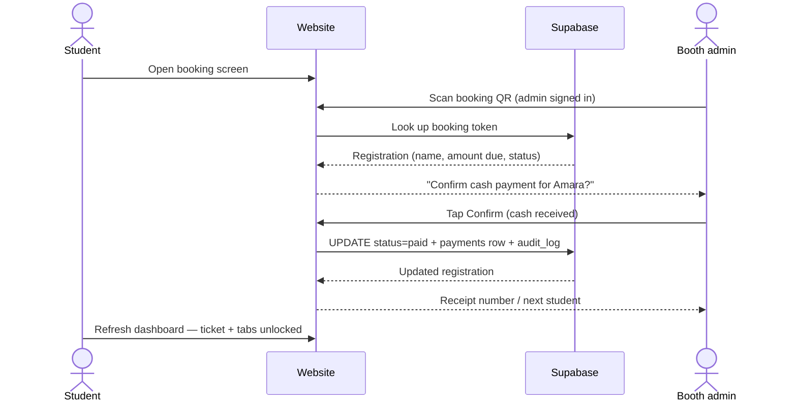
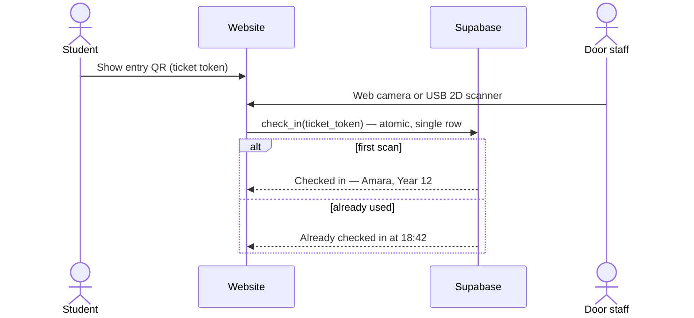

# Christmas Event Ticketing System — Project Spec

**Version 0.3 · reviewed 13 Nov 2026**
**Event:** Saturday 19 December 2026 *(confirm — assumed from the working prototype)*
**Owners:** Steven (Lucky Draw) · Terrence (Event Guides) · Adam (Activity Registration) · Marcus (Food Passes) · Coby (Registration Form) · Martin (Database) · TBD (Door Ops) · TBD (Payments/Admin) · TBD (QA & Security)
**Status:** Initiation closing. Spec freeze **16 Nov**. A working prototype of every flow already exists in this repo (`dist/index.html` for the UI/UX, `server.py` for the Excel-backed logic) — use it as the interaction reference, not the production code.

> **TL;DR:** One Next.js + Tailwind app on Vercel, Supabase for auth/Postgres/RLS, cash only, QR tickets. The stack in the draft conflicts (Next.js *and* Reflex), the "QR codes" line conflates QR with 1D barcodes, Excel can't be the live database, and a password was pasted in plaintext. All fixed below.

---

## 0. Review notes — what changed from the draft

| # | Draft issue | Correction |
|---|---|---|
| 1 | A plaintext password was pasted into the earlier draft of this document | **Treat as compromised. Rotate it today**, enable 2FA on GitHub/Vercel/Supabase/Google, store secrets in a password manager + Vercel env vars. Never put credentials in a doc, Discord, or repo. |
| 2 | "Coding platforms: Next.js **and** Reflex (Python)" | Contradictory. Next.js is the frontend/server framework; Reflex is a full-stack Python framework with its own frontend. **Pick Next.js + Tailwind + Supabase** (matches Vercel). Drop Reflex. |
| 3 | "Database: Microsoft Excel **Supabase**" | One source of truth: **Supabase (Postgres)**. Excel is an **export/import format** for the booth, kitchen, and backup — never the live DB. Excel breaks under concurrent edits and has no access control. |
| 4 | "Old QR code scanners from the school" | Verify by **18 Nov**. Many school scanners are 1D laser scanners and **cannot read QR at all**. You need a 2D imager (QR) that acts as a USB keyboard, or use staff phones with the web scanner. Fallback: print **Code 128** barcodes for 1D scanners. |
| 5 | "How to purchase QR code?" | You don't buy QR codes. Generation is free (library). You buy **printing** and **scanning hardware**. See §8. |
| 6 | "QR code scanned into a barcode scanner… disable the QR" | Phrase it as **check-in + one-time use**, not deletion. Allow a re-scan to show *"already checked in at 18:42"* for door staff, and let admins undo mistakes. |
| 7 | "Website instantly unhides hidden tabs" | Hide in the UI **and** guard on the server (RLS + route checks). UI-only hiding is not security; a student could call the API directly. |
| 8 | No amounts, no owners for half the modules, empty sections | Budget, timeline, data model, security checklist, acceptance criteria, and open questions added below. |
| 9 | "Penetration testing" 30 Nov–4 Dec | Rename to **security testing on our own deployment**. 4 days is generous for a student review but do not call it a professional pen test; scope it, use test accounts, no third-party targets, no denial-of-service. |
| 10 | Payment question | Confirmed decision: **in-person cash only**. No card data ever touches the site. Cash handling follows school finance policy (§10.5). |

**Two decisions needed at the 16 Nov meeting:** the scanner model (2D or 1D) and whether accounts are school-email-only or student-ID-based (§15).

---

## 1. Overview

A single website ("umbrella site") that runs one school Christmas event end to end:

1. **Intake** — a student signs up, one registration per person, locked by a unique constraint.
2. **Payment** — status starts `pending`; an admin at the lunch booth scans the student's booking screen and confirms cash payment, which flips them to `paid`.
3. **Door** — a paid student shows a unique QR ticket; staff scan it once; the ticket is marked used and entry is logged.
4. **Experience** — once paid, the dashboard unlocks: entry ticket, lucky draw entry, event guides, activity sign-ups, food pass.
5. **Admin** — see paid / unpaid / discounted / free at a glance, export lists, fix mistakes, audit every status change.

### Goal

A working, auditable system for **≈300–1,000 students** that the events team can operate without a developer on the day.

### Non-goals (this event)

- Online payments, card processing, vendor verification.
- Multi-event SaaS, public ticketing, waitlists across events.
- Native mobile apps.

### Success metrics

- 0 duplicate registrations (unique email/student ID enforced).
- 0 unpaid students entering at the door.
- Door throughput ≥ 4 students/minute/lane.
- < 2 minutes average from booth scan to dashboard unlock.
- Every payment and check-in traceable to an admin account.
- CSV export of final headcount, dietary needs, and winners for the kitchen/office.

---

## 2. Users & roles

| Role | Who | Can |
|---|---|---|
| **Student** | Anyone with a school account | Register once, view own booking/ticket, sign up for activities, pick food, enter draw (if paid) |
| **Booth admin** | 1–2 trusted students/staff | Search a student, scan booking QR, confirm cash payment, issue receipt, mark comp/discount |
| **Door staff** | Volunteers at the entrance | Scan tickets, see "checked in / already in", manual lookup by name or ticket ID |
| **Super admin** | Project lead / teacher | Everything, plus refunds, cancellations, account roles, event settings, exports, audit log |
| **Teacher/finance** | School staff | Read-only payment and headcount reports |

Roles live in `profiles.role` and are enforced by RLS and server checks. **No role is trusted from the client** — every privileged action re-checks the session server-side.

---

## 3. Stack decision

### Chosen

| Layer | Choice | Notes |
|---|---|---|
| Framework | **Next.js 15 (App Router, TypeScript)** | Pages + route handlers in one deploy; works natively on Vercel |
| Styling | **Tailwind CSS** | Already in the plan; keep the prototype's design tokens as the palette source |
| Auth | **Supabase Auth** | School email domain allow-list; magic link or Google Workspace SSO; test school spam filters early |
| Database | **Supabase Postgres** | Row Level Security, migrations, daily backups |
| File/asset hosting | Vercel (static) + Supabase Storage if needed | QR images are generated client-side; no storage needed |
| Hosting | **Vercel Hobby** (`*.vercel.app` domain) | Free for a school event; custom domain optional |
| QR generation | `qrcode` npm package (client-side) | Free |
| QR scanning | `@zxing/browser` or `html5-qrcode` (camera) + USB 2D scanner (HID keyboard) | Two paths, same input box |
| Excel export/import | `xlsx` (SheetJS) | Exports only; not a live DB |
| Region | Supabase **Singapore (ap-southeast-1)**, Vercel functions **sin1/hkg1** | Best latency from Hong Kong |

**Why not Reflex:** it would replace Next.js *and* Tailwind's role, can't deploy on Vercel the same way, and doubles the learning surface two weeks before launch. Using both means two backends and two deployment stories.

**If the team is Python-only,** the alternative is Reflex or Django *instead of* Next.js — but decide at the 16 Nov meeting, not halfway through. Do not mix.

### Environment & secrets policy

- `.env.local` (gitignored) + Vercel Environment Variables for `NEXT_PUBLIC_SUPABASE_URL`, `NEXT_PUBLIC_SUPABASE_ANON_KEY`, and `SUPABASE_SERVICE_ROLE_KEY`.
- The **anon key is public by design**; the **service role key is not** — server-only, never in a client component or `NEXT_PUBLIC_*` variable.
- Rotate the leaked credential from the draft immediately; enable 2FA on every service account.
- No credentials in the repo, the Discord, or this document.

### What already exists

The prototype in this repo implements the full UX and rules (registration, QR ticket, scan desk, draw, guides, admin, Excel export). Port flow-by-flow; do not reuse the Python server as production.

---

## 4. Core flows

### 4.1 Intake (registration)

1. Student signs in with school email; account is linked to `profiles.id`.
2. Form collects: name, student ID/year group (if not in auth), dietary needs + allergies, activities, emergency/contact note (optional), consent for photos (optional).
3. Submit inserts one row into `registrations` with `status = pending`, unique on `(event_id, profiles.id)` and on school email. The database — not the UI — prevents duplicate submissions.
4. Response shows a **Booking ID screen** with a QR code and the text: *"Go to the ticket booth at lunch, show this screen, and pay the entry fee."*

### 4.2 Payment activation (cash at the booth)

Rules:

- The booking QR encodes a **single-use booking token**, not the student's personal ID or ticket.
- Confirming requires an authenticated **booth-admin** session; the token is not a credential by itself.
- The confirm page shows name + year group + amount due; the admin must visually match the student.
- Cash is recorded with `received_by`, amount, and receipt number. **No card data.**
- Statuses: `pending → paid` (happy path), or `pending → comped` / `discount` with a reason field and supervisor approval, `paid → refunded` (super admin only, reason required).
- The dashboard does not "unhide" client-side only; the ticket route and every feature route check `status === paid` server-side.

### 4.3 Door check-in

Implementation requirements:

- The check-in is a **single atomic operation** (unique constraint on `checkins.registration_id`, or `UPDATE … WHERE checked_in_at IS NULL`). Two scanners at the same instant must not both "succeed".
- The QR payload is an opaque **ticket token** (128-bit random, unguessable), e.g. `https://<domain>/t/<token>`. It contains no name or email.
- Re-scanning must **show** the original check-in time and staff member — it must not silently fail or grant a second entry.
- Manual fallback: search by name / ticket ID / last 6 characters; server logs which method was used.
- Admins can undo a check-in (with audit log).
- Ticket is revoked if a registration is refunded or cancelled.
- **Door result screen:** big green "IN — name" or amber "ALREADY IN — 18:42"; sound + vibration; works on a phone in landscape.

### 4.4 Unpaid / invalid at the door

- `pending`: "Not paid — send to the booth", with a shortcut to mark paid if a booth admin is at the door.
- `refunded`/`cancelled`: "Ticket cancelled", escalated to a supervisor.
- Unknown token: "Ticket not recognised", offer manual name lookup.
- Never expose why beyond what staff need; never show payment or dietary data on the door screen.

### 4.5 Food passes

- One `food_pass` per paid registration, generated with the ticket.
- Student selects: none / standard / vegetarian / vegan / halal / allergy notes. Counts are exported for the caterer (CSV with counts by year group, no email addresses).
- At the food queue a volunteer marks the pass redeemed (scan or lookup) — optional if throughput is a concern; default is **show-and-tick, not scanned**, to avoid a second queue bottleneck.
- Allergen data goes to the catering lead only (need-to-know), not onto public screens; include a printed allergy sheet at the kitchen.

### 4.6 Activity registration

- `activity_slots` are content rows (name, capacity, time, location) that an admin can create without code.
- Student picks activities after payment; capacity enforced by a database function (no overselling under concurrency); full slots offer a waitlist.
- Time clashes are validated against the event schedule.
- Student can cancel/change until a configurable lock date; roster is exportable per slot.

### 4.7 Lucky draw (Steven)

- Eligibility: `status = paid` **and** checked in. One entry per student (unique constraint) — no buying extra entries.
- Draw runs from the admin panel on a **projector-safe screen**: shows first name + surname initial only, never email/ID.
- Winner is written to `draw_winners` with `prize_id`, timestamp, and the admin who ran it; winner must be present, redraw rule after 30 seconds.
- No repeats unless the prize is explicitly marked repeatable; all state survives a refresh mid-event.
- Prize list and quantities are content rows (`prizes`), not hard-coded.

---

## 5. Data model (Supabase)

Enums: `reg_status` = `pending|paid|comped|refunded|cancelled` · `price_tier` = `full|discount|free` · `role` = `student|booth_admin|door_staff|super_admin|finance`.

| Table | Key columns | Constraints |
|---|---|---|
| `profiles` | `id` (uuid, = auth uid), `school_email`, `student_id`, `full_name`, `year_group`, `role` | unique `school_email`, unique `student_id` |
| `events` | `id`, `name`, `starts_at`, `fee_cents`, `currency`, `signup_open_at`, `signup_close_at` | one active row for this event |
| `registrations` | `id`, `event_id`, `profile_id`, `status`, `price_tier`, `amount_due_cents`, `amount_paid_cents`, `booking_token`, `ticket_token`, `paid_at`, `paid_by` | **unique `(event_id, profile_id)`**, unique tokens, `booking_token` rotatable |
| `payments` | `id`, `registration_id`, `method='cash'`, `amount_cents`, `received_by`, `receipt_no`, `created_at` | receipt_no unique |
| `checkins` | `id`, `registration_id` (unique), `checked_in_at`, `by_profile_id`, `method` | unique `registration_id` → no double entry |
| `activity_slots` | `id`, `name`, `capacity`, `starts_at`, `location` | capacity > 0 |
| `activity_signups` | `id`, `slot_id`, `registration_id`, `status` | unique `(slot_id, registration_id)` |
| `food_preferences` | `registration_id` (PK), `diet`, `allergies`, `notes` | |
| `food_passes` | `id`, `registration_id` (unique), `redeemed_at`, `redeemed_by` | |
| `prizes` | `id`, `name`, `quantity`, `repeatable` | |
| `draw_winners` | `id`, `prize_id`, `registration_id`, `drawn_at`, `drawn_by` | unique `(prize_id, registration_id)` |
| `guides` | `id`, `slug`, `title`, `body_md`, `published` | public read |
| `audit_log` | `id`, `actor_id`, `action`, `registration_id`, `meta` (jsonb), `created_at` | insert-only |

**RLS in one line each:**

- `registrations`: student selects/updates own row, but **cannot** change `status`, `amount_*`, or tokens; admins can.
- `payments`, `checkins`, `audit_log`: students read nothing; booth/door admins create through server routes (or security-definer functions); super admin reads.
- `guides`: public read where `published`.
- `draw_winners`: admin write; event screen reads names only via a view.

**Ticket/booking token design**

- `ticket_token`: 128-bit random, base32/URL-safe, stored in DB, QR encodes `…/t/<token>`; revocable on refund.
- `booking_token`: separate, rotatable, single-use for the payment confirmation; expires 7 days.
- Human fallback code: last 6 characters of the ticket token shown under the QR, used only by staff lookup.

**Backups & exports**

- Supabase daily backups (free tier covers basic); **export CSV/XLSX before the event and after** and store in the school drive.
- Post-event retention: export stats, then delete PII within 30 days (§10.4).

---

## 6. Routes / API surface (Next.js)

| Route | Access | Purpose |
|---|---|---|
| `/` | public | Landing: event details, countdown, sign-in |
| `/register` | student | Form + submit |
| `/dashboard` | student | Status, booking QR, ticket QR (paid only), tabs |
| `/t/[token]` | public (token) | Ticket display / door lookup page |
| `/draw` | paid + checked in | Entry confirmation + live draw screen |
| `/guides` | paid | Event guides (`guides` rows) |
| `/activities` | paid | Slot list + sign-up |
| `/food` | paid | Dietary selection + food pass |
| `/admin` | role-gated | Overview + filters (paid/pending/comped/discount) |
| `/admin/pay/[token]` | booth_admin | Confirm cash payment |
| `/admin/checkin` | door_staff | Camera scanner + manual lookup |
| `/admin/draw` | super_admin | Run draw, history |
| `/admin/registrations` | admin | Search, export, edit status (audited) |
| `/admin/exports` | admin | Headcount, dietary, activity rosters, winners |
| `POST /api/checkin` | door_staff | Atomic check-in (server-side) |
| `POST /api/payment/confirm` | booth_admin | Mark paid (server-side) |

Middleware checks the session on every protected route; the client never receives the service role key.

---

## 7. QR codes — generation, printing, scanning

**You do not purchase QR codes.** They are free to generate. What costs money:

1. **Scanning hardware.** Confirm what the school has:
   - A **2D imager** scanner (reads QR as a USB keyboard) — ideal, works with a focused input field.
   - A **1D laser** scanner — **cannot read QR**. Either print **Code 128** barcodes instead, or use staff phones.
   - Phones + the web scanner — free, needs HTTPS (Vercel provides it) and decent light.
2. **Printing**, only if you want a paper fallback: A6 ticket cards or a "no phone" list. The normal ticket lives on the student's phone screen.

**Decision gate — 18 Nov:** test the exact school scanner on a printed QR and a phone screen. Record the model number and result in this doc. If it is 1D-only, the door flow becomes "phone camera scan at `/admin/checkin`" or a Code 128 fallback.

**Offline / wifi failure plan:** before the event, print the paid guest list (name + ticket code) and keep a manual check-in sheet; one door laptop on a phone hotspot; admins can reconcile the paper sheet afterwards. Test the venue wifi with 10 simultaneous devices in the rehearsal.

---

## 8. Admin panel requirements

- Tabs/filters: **All · Paid · Pending · Comped · Discount · Refunded · Cancelled**, plus search by name/email/ticket/receipt.
- Each row: name, year group, status, amount due/paid, paid by, checked-in time, actions.
- Actions: mark paid (cash), mark comp/discount with reason + supervisor, refund (super admin, reason), undo check-in, resend booking screen, edit name/email typo, export.
- **Audit log** visible per registration: who changed what, when.
- Bulk export: headcount, dietary list with counts, per-activity rosters, winners, reconciliation report (cash expected vs received vs receipts).
- Counters at the top: registered / paid / pending / checked in / prizes drawn.
- Print-friendly door list and kitchen list.
- No student PII beyond what a role needs; no export of emails to the kitchen.

**Prototype note:** the working prototype in this repo has a password-gated admin panel (PBKDF2-SHA256 hash, 12-hour session, server-side session cookie on the Python build). Treat that as a **screen lock for the kiosk**, not authorization — the production build must use Supabase Auth roles and RLS (§3, §9). Never reuse the prototype password for a real account.

---

## 9. Security & privacy

### 9.1 Immediate: leaked credential

The draft contains a plaintext password. Rotate it now, enable 2FA everywhere, and check the provider's active-sessions page for unfamiliar logins. Assume it was shared further than intended.

### 9.2 Baseline

- Auth: Supabase Auth, school email domain allow-list, email verification, session expiry.
- Authorization: RLS everywhere + server-side role checks; never trust `status` from the client.
- Tokens: unguessable, revocable, single-purpose; rate-limit lookup and confirm endpoints.
- Input validation and length limits on every field; React escapes output, but export files need **CSV-injection** protection (prefix `'` on cells starting `=`, `+`, `-`, `@`).
- HTTPS only; secure cookies; no secrets in the browser bundle.
- Log admin actions; alert on repeated failed confirm attempts.
- Dependencies: `npm audit`, lockfile committed.
- Backups + a tested restore path (restore into staging once).

### 9.3 Security test scope (1–3 Dec)

On **our own** deployment, with test accounts, no DoS, no third-party targets. Checklist:

1. Student cannot read another student's registration via URL or API (IDOR).
2. Student cannot set their own `status=paid` by calling the API.
3. Booking token cannot be replayed after payment; ticket token cannot be brute-forced.
4. Double check-in race: two scanners at once → exactly one success.
5. `anon` key exposes nothing via RLS on every table.
6. Service role key absent from the client bundle and repo history.
7. Rate limiting on register / confirm / lookup.
8. XSS through name, notes, dietary fields (and stored XSS in admin views).
9. CSV injection + formula injection in exports.
10. Email enumeration via signup / duplicate messages.
11. Role escalation: student → admin by tampering with cookies/localStorage/JWT.
12. Refund/cancel revokes the ticket and blocks the door.

Write findings in the audit-log sheet with severity and owner; fix blockers before signups open.

### 9.4 Student data

- Collect the minimum: name, school email, year group, dietary (only if food), activity choices, consent flags.
- Dietary/allergy data: need-to-know (catering lead + first aid), not displayed publicly.
- Minors: follow school policy; document parental consent where required.
- Photos: opt-in flag; no photos of students without it; no photos of the draw screen with full names.
- Retention: export event stats, then delete personal data within 30 days (or per school policy). Say so in the privacy notice at registration.

### 9.5 Cash handling (not a website problem, but still a requirement)

- Float, receipt book, two-person count at close, reconciliation sheet, secure drop with school finance.
- Booth admin cannot also be the person reconciling.
- Refunds require the event lead's approval and a receipt.

---

## 10. Budget (HK$, student event)

| Item | Required? | Est. cost | Notes |
|---|---|---|---|
| Vercel Hobby | Yes | **$0** | `*.vercel.app` subdomain included; school/non-commercial use |
| Supabase Free | Yes | **$0** | 500 MB Postgres + auth; ample for 1,000 students |
| Custom domain | Optional | $0 (free subdomain) / ~$150/yr | Only if the school wants a branded link |
| QR generation | Yes | **$0** | `qrcode` library; booking + ticket QRs generated in the browser |
| 2D QR scanner ×2 | Only if school scanners are 1D | $250–500 each | USB HID; test before buying |
| Phone-based scanning | Yes | **$0** | Staff phones + web scanner (needs HTTPS, provided) |
| Printed fallback tickets/lists | Recommended | $100–300 | A6 cards or A4 paid-list for offline door |
| Signage / posters at booth | Recommended | $100–200 | QR "how to pay" instructions |
| Receipt book / stationery | Yes | ~$50 | Or printed receipt template |
| Cash float | Yes | ~$1,000 | Not a cost — recovered at close |
| Prizes / food | Event budget | TBD | Separate from platform budget |
| Contingency (≈15%) | — | $250–400 | Hardware/printing surprises |
| **Platform + hardware total** | | **≈$1,000–3,000** | **≈$0–500 if the school already has 2D scanners and you print nothing** |

Costs to verify: scanner prices, printing quote, whether the school has a finance-approved cash process, whether Vercel/Supabase free tiers are acceptable to the school (check with IT; some schools require paid/owned accounts for student data).

---

## 11. Timeline (as of 13 Nov 2026)

| Dates | Milestone | Owner | Exit criteria |
|---|---|---|---|
| **13–16 Nov** | Spec freeze, schema, auth spike, **test school scanner on a printed QR** | Martin + Coby + lead | This doc signed off; scanner decision recorded |
| **16–20 Nov** | Auth, registration + unique constraint, booking screen, ticket token | Coby + Martin | Student can register once; duplicate blocked; booking QR works |
| **20–24 Nov** | Booth payment flow, status machine, admin filters, audit log | TBD (Admin) | Cash confirm flips to paid; audit row written |
| **23–27 Nov** | Modules: draw (Steven), guides (Terrence), activities (Adam), food (Marcus) | Module owners | Each passes its acceptance criteria (§15) |
| **27–30 Nov** | Integration, door scanner route, exports, mobile pass | All | End-to-end on staging with 20 test accounts |
| **1–3 Dec** | Internal QA + security checklist; **door rehearsal #1** | QA TBD | Blockers fixed; rehearsal notes logged |
| **4 Dec** | **Signups open** (booth payments from Mon 7 Dec) | All | Monitoring on; daily backup |
| **7–9 Dec** | Security testing round; load check (100 concurrent) | QA TBD | No critical/high findings open |
| **15 Dec 23:59** | Signups close; **code freeze** (emergency fixes only) | Lead | Final paid list export |
| **16–18 Dec** | Door rehearsal #2, print fallback lists, staff briefing, receipts reconciled | Door Ops | Everyone has a role and a device |
| **19 Dec** | **Event** | All | Door, food, draw, guides live |
| **20–31 Dec** | Export stats, delete PII, retro | Lead | Retention done |

**Realistic warning:** the draft allots 4 days for "final runs + pen testing" while development is still finishing. Build a thin vertical slice first (register → pay → ticket → door) by 24 Nov, then add modules. If a module is behind on 30 Nov, cut it: the ticket + payment + door path is non-negotiable; the draw and guides can run from a spreadsheet/manual fallback for one night.

**Freeze rules:** no schema changes after 15 Dec; no deploys after 15 Dec except security fixes; content edits via admin only.

---

## 12. Testing plan

**Happy paths:** register → pay → ticket → door → draw entry → food pass → activity signup.

**Edge cases to test explicitly:**

- Duplicate registration (same account, same email, different case).
- Payment confirmed twice / booking token replayed.
- Two door scanners scanning the same ticket simultaneously.
- Unpaid student at the door; refunded ticket at the door.
- Phone dies at the door → manual lookup by name/ticket ID.
- Wifi drops mid-check-in; offline fallback list used and reconciled.
- Student changes food choice after paying; caterer counts update.
- Activity oversubscription under two simultaneous sign-ups (database function, not UI).
- Draw winner already won a different prize; draw state survives refresh.
- Admin accidentally marks the wrong student paid → undo + audit.
- 100 concurrent registrations; 1,000-row export opens in Excel.
- Safari/iOS and Chrome/Android; school Chromebooks.

**Rehearsal script (45 min):** 10 fake students register on 3 devices → booth confirms 5 (one comped, one discounted) → door scans 3, double-scans 1, unpaid tries 1 → run the draw twice → export everything → reconcile cash. Time it. Assign someone to write down friction.

---

## 13. Risks

| Risk | Impact | Mitigation |
|---|---|---|
| School scanner is 1D-only | Door flow broken | Test 18 Nov; use phones or Code 128 fallback |
| Wifi failure at the door | Check-in stops | Hotspot + printed paid list + manual reconciliation |
| Dev slips 1 week | Launch pressure | Vertical slice by 24 Nov; cut non-essentials |
| Two stacks (Next.js + Reflex) | Nothing ships | Decide 16 Nov; drop one |
| Cash mistakes / missing receipts | Financial loss | Two-person count, receipts, reconciliation sheet |
| PII leak (emails, dietary, minors) | Safeguarding incident | RLS, need-to-know exports, retention policy |
| Students share ticket screenshots | Tailgating | One-time check-in + name shown to staff; log first scan |
| Admin account compromise | Fake payments | 2FA, role separation, audit log, rate limits |
| Wifi captive portal blocks Vercel/Supabase | App unavailable | Test on school network early; ask IT for allow-list |

---

## 14. Open questions — need answers at the 16 Nov meeting

| Question | Recommended default |
|---|---|
| Expected student count? | Design for 600; load-test 100 concurrent |
| Entry fee and currency? | Decide before 16 Nov; e.g. HK$40 |
| Who can approve discounts/free entry? | Event lead only; reason + audit |
| School email domain(s) and is mail deliverable? | Confirm with IT; test magic links |
| Are students minors; parental consent needed? | Follow school policy; photo consent opt-in |
| Can the school's network reach Vercel/Supabase? | Ask IT for domain allow-list |
| Scanner models available? | Test on 18 Nov; record model |
| Devices at the door (phones/laptops)? | 2 phones + 1 laptop + power banks |
| Food headcount deadline to caterer? | 16 Dec |
| Prize budget and donors? | Steven to confirm |
| Language(s) | English; add Chinese copy if required |
| Who is on call during the event? | One dev + one super admin + teacher |

---

## 15. Definition of done (per module)

- **Registration (Coby):** one row per student enforced in DB; duplicate attempt shows a friendly message; booking QR screen works on iOS + Android; no PII in the QR.
- **Payments/Admin (TBD):** confirm flow requires admin auth; status changes audited; filters show paid/pending/comped/discount; export matches DB.
- **Door (Door Ops):** scan or manual lookup; green/amber/red states; double scan reports the first time; undo works; offline list agreed.
- **Lucky draw (Steven):** eligible = paid + checked in; no repeats; winner persisted; projector-safe display; redraw rule implemented.
- **Guides (Terrence):** content editable without a deploy; mobile-readable; accessible headings/contrast.
- **Activities (Adam):** capacity enforced atomically; clash detection; roster export.
- **Food passes (Marcus):** dietary selection saved; counts export; allergen sheet to catering; redemption optional but logged.
- **Project:** security checklist passed; rehearsal #2 signed off; backup + retention complete.

---

## Appendix A — prototype status (already in this repo)

| Prototype feature | Maps to production |
|---|---|
| Registration form + QR ticket (single page, hash routes) | `/register`, `/dashboard` |
| Scan desk (camera + manual code, duplicate warning, chime) | `/admin/checkin`, `POST /api/checkin` |
| Lucky draw (server-side pick, no repeats, history) | `/admin/draw`, `draw_winners` |
| Guides rendered from `data/guides.json` | `guides` table |
| Admin list, manual check-in, Excel export | `/admin/registrations`, exports |
| Excel/localStorage storage (demo only) | → Supabase Postgres |

The prototype is useful for **UX review and flow sign-off**, not as the production backend. Export its design tokens, copy, and route names into the Next.js build.

## Appendix B — one-line answers to the original questions

1. **Excel names on sign-up:** no manual entry — form writes a Supabase row; Excel is export-only.
2. **Dynamic database:** schema migrations + content tables (prizes, slots, guides) editable by admins.
3. **How to purchase QR codes:** you don't; generation is free, printing/scanning costs money.
4. **Unique ticket IDs:** 128-bit opaque token in the URL, revocable; short fallback code for staff.
5. **Flag unpaid:** `status=pending`; RLS + server checks hide the ticket and block the door; admin filters.
6. **Admin panel:** paid/pending/comped/discount/refunded tabs, search, audit, exports.
7. **Separate tasks into tabs:** yes — app nav tabs, this doc by section, and a task board with one owner + acceptance criteria per module.
8. **Online payment legality:** not doing it. Cash at the booth, no card data, school finance process.
